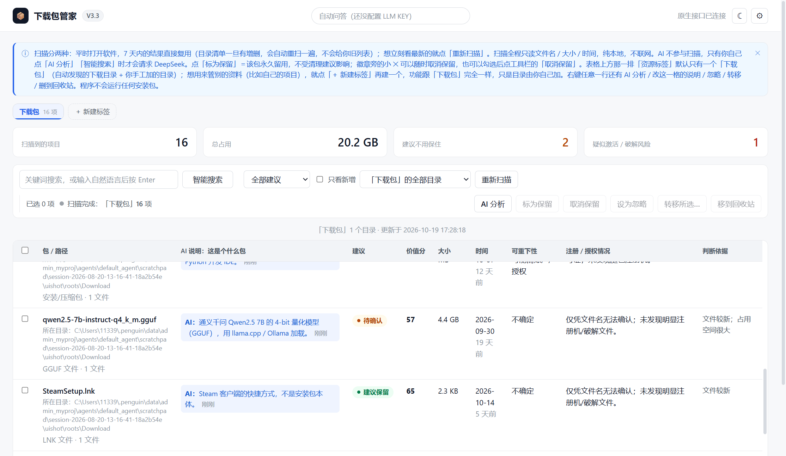
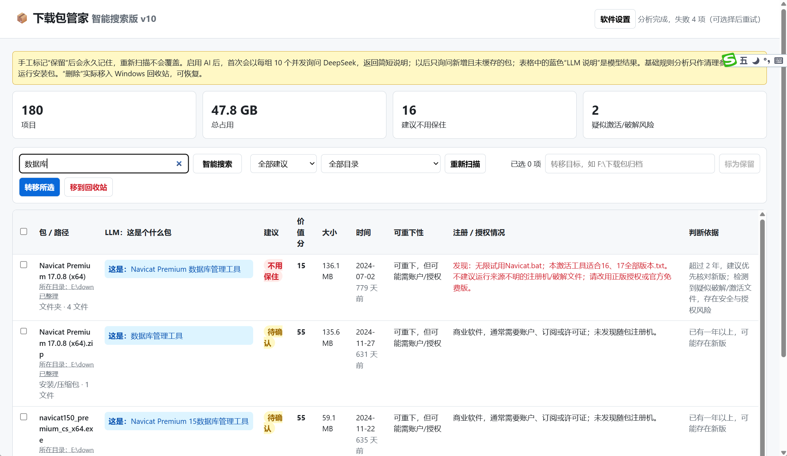
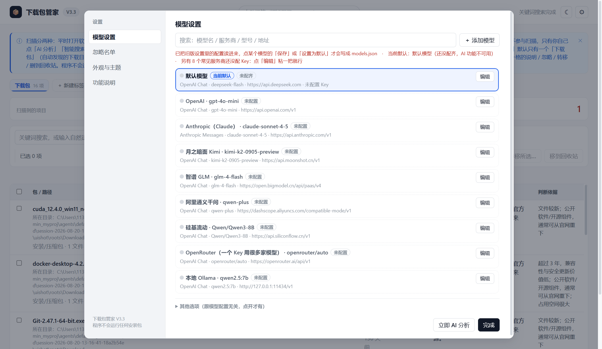
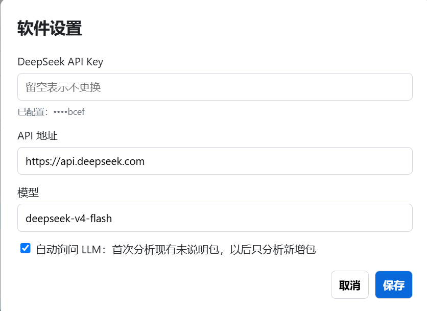

# 📦 下载包管家（桌面 AI 版）

> **你的下载目录，AI 帮你管。** 一款运行在本机的下载包智能整理工具——自动扫描、AI 识别、风险预警、一键整理，再也不用面对几 TB 的"下载"文件夹发愁。

当前版本：**智能搜索版 v11（1.1.1）** ｜ 绿色免安装 ｜ Windows 10/11

---

## ✨ 亮点功能

### 🤖 AI 语义搜索——用一句话找到想要的包
不用记文件名，直接输入自然语言，比如"找那个装 CUDA 的安装包""把破解版软件都列出来"。本地关键词匹配 + 中文分词向量召回 + DeepSeek 语义扩展三重命中，精准定位。

### 🧠 每个下载包都有 AI 说明
选中任意包，AI 立刻告诉你：**它是什么、还值不值得留、能不能重新下载、有没有授权/破解风险**。AI 说明按名称+大小+时间持久缓存。

### 🚨 破解 / 注册机风险预警
自动识别目录中的 `crack`、`keygen`、注册机、破解补丁等可疑文件，并在整理建议中明确提示安全与授权风险——**只提示，不运行**。

### 💡 智能整理建议（价值评分）
每个包给出 0–100 价值分和明确建议：**建议保留 / 待确认 / 不用保住**。判断依据公开透明（新旧程度、占用空间、是否公开软件、能否重下），你可以自己复核。表格任意列都能点表头排序，也能一键"只看新增"，快速筛出本次新出现的包。

### ⚡ 批量操作，一步到位
多选后一键**转移到归档目录**或**移入回收站**，不想被误删的包可以点"标为保留"——永久留用，不受清理建议影响。转移目标填一次就会记住；批量操作会逐项汇报成功多少、哪些失败及原因。

### 🔌 设置页自己就能验通
【模型设置】里可以改 API Key、API 地址、模型，点"测试连接"直接拿到连通性与延迟（并列出账号可用模型），点"清除 Key"可一键抹掉已保存的密钥。

### 🔒 隐私安全，全部本地
- 纯本地运行：pywebview 桌面窗口，**不对外开放端口**（仅 pywebview 内部用本机回环随机端口，窗口关闭即释放）
- API Key 用 **Windows DPAPI 加密**后落盘，界面只显示尾号，不回显完整密钥；配置与数据存于 `%LOCALAPPDATA%\DownloadPackageManager`
- 仓库不含任何敏感配置，`settings.json` 已被 git 忽略

### 🎯 专为"下载强迫症"设计
每周自动扫描一次（扫描结果缓存复用，不会每次打开都全盘扫；随时可手动"重新扫描"刷新，扫描过程中会显示当前进度）。自动扫描各盘根目录下名称含 `down` / `下载` 的文件夹，每个一级项目就是一个下载包；也支持**手工添加任意扫描目录**，永久参与扫描。目录读取失败会标出来而不是静默跳过。

---

## 🚀 快速开始

### 直接使用（推荐，无需装 Python）

👉 **[⬇️ 下载 DownloadPackageManager-v11.exe](https://github.com/chenlinzhe/download-manager/releases/latest)**

下载后**双击运行**即可。首次使用在【模型设置】中填入你的 DeepSeek API Key（可自选模型，默认 `deepseek-v4-flash`）。

### 从源码运行

```bash
pip install -r requirements.txt   # pywebview + jieba（智能搜索的中文分词）
python desktop.py                 # 或双击 启动下载包管家桌面版.bat
```

### 运行测试

```bash
python -m unittest discover -s tests -v
```

### 自己打包 EXE

```bash
powershell -ExecutionPolicy Bypass -File build.ps1
# 产物在 dist/，可直接发布（图标 app.ico、版本资源 version_info.txt 已接入 spec）
```

---

## 📸 界面预览

| 主界面：扫描结果 + AI 说明 + 价值评分 | 智能搜索：自然语言直接找到下载包 |
| --- | --- |
|  |  |

| 模型设置：DeepSeek API Key、连接测试与模型配置 | AI / LLM 说明：用途、价值与风险提示 |
| --- | --- |
|  |  |

---

## 🗂️ 本地数据

配置与持久数据保存在 `%LOCALAPPDATA%\DownloadPackageManager`：

| 文件 | 内容 |
| --- | --- |
| `settings.json` | API 地址、模型、加密后的 API Key（DPAPI）、转移目标 |
| `ai_descriptions.json` | AI 说明缓存 |
| `inventory.json` / `inventory_snapshot.json` | 扫描指纹与扫描快照（一周内复用） |
| `user_labels.json` | "标为保留"的手工标记 |
| `collection_classifications.json` / `collection_failures.json` | 集合目录判定结果与失败退避记录 |

> 本仓库仅含干净源码：构建产物 `build*/dist*/node_modules` 不提交，EXE 通过 **GitHub Releases** 发布；旧浏览器/服务端入口（`server.py`）保留用于兼容，桌面版入口为 `desktop.py`；早期 Electron 实现已移到 `legacy/`。

## 📄 开源协议

未指定（默认保留所有权利）。如需开源可自行补充 LICENSE。
