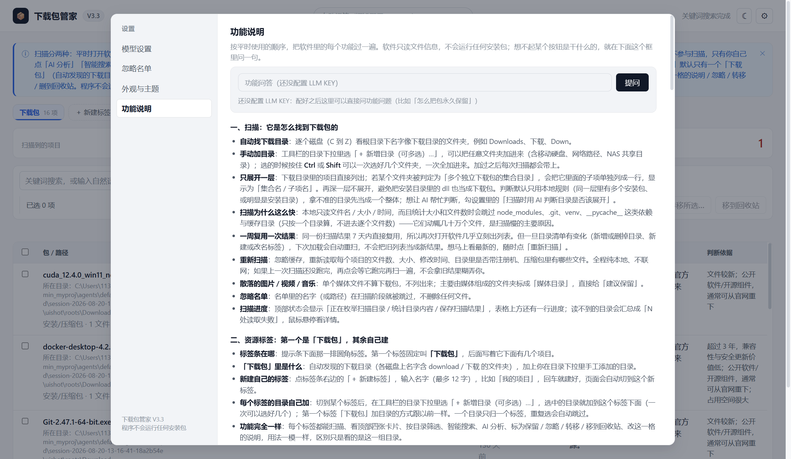

# 📦 下载包管家（桌面 AI 版）

> **你的下载目录，AI 帮你管。** 一款运行在本机的下载包智能整理工具——自动扫描、AI 识别、风险预警、一键整理，再也不用面对几 TB 的"下载"文件夹发愁。

当前版本：**V3.3** ｜ 绿色免安装 ｜ Windows 10/11 ｜ 扫描纯本地，AI 只有你点的时候才跑

👉 **[⬇️ 下载 DownloadPackageManager-v33.exe](https://github.com/chenlinzhe/download-manager/releases/latest)**

---

## 📸 界面预览

下面都是 V3.3 的真实界面截图（用的是演示数据，没有任何个人文件）：

| 主界面：扫描结果 + AI 说明 + 价值评分 | 智能搜索：一句话找到想要的包 |
| --- | --- |
|  |  |

| 设置 → 模型设置：九家服务商预置，粘个 Key 就能用 | 设置 → 功能说明：每个功能逐条讲清楚，还能直接提问 |
| --- | --- |
|  |  |

---

## ✨ 亮点功能

### 🤖 AI 语义搜索——用一句话找到想要的包
不用记文件名，直接输入自然语言，比如"找那个装 CUDA 的安装包""能在本机跑大模型的那个"。本地关键词匹配 + 中文分词向量召回 + 默认模型的语义扩展三重命中，精准定位；结果旁边会写清这次走的是「关键词 + AI 语义」还是「只有关键词」（没配 Key、网络不通、调用失败都会退回关键词结果，不会白等）。

### 🔍 扫描纯本地，AI 只在你要用时才跑
扫描只读文件名 / 大小 / 时间，**不联网、不花额度、不动文件**；「重新扫描」立刻重扫，平时复用 7 天内的结果，而一旦目录清单有增删就自动重扫——不会再出现"点扫描没反应、列表还是老的"。统计大小和文件数时会**跳过 node_modules、.git、venv、__pycache__ 这类依赖与缓存目录**（只按一个目录算，不进去逐个文件数），所以带一堆依赖的项目目录也能几秒扫完；扫描时进度条会显示正在统计哪个目录、走到第几个。AI 只在你点「AI 分析」「智能搜索」时才请求模型；连"这个目录是不是多个包的集合"这种判断，默认也走本地规则 + 以前缓存的结论，想让它参与就去设置里勾「扫描时用 AI 判断目录是否该展开」（默认关闭）。

### 🧠 每个下载包都有 AI 说明
选中任意包，AI 立刻告诉你：**它是什么、还值不值得留、能不能重新下载、有没有授权/破解风险**。AI 说明按名称+大小+时间持久缓存；**已经分析过、文件又没变的项目会直接跳过**（不是有时限，而是命中缓存），并在工具栏左边的信息条里明确告诉你「这 N 项 X 分钟前分析过，文件没变，不用再分析」，每个单元格后面也标着「X 分钟前」；想强制重做就**按住 Shift 点「AI 分析」**。**压缩包会先读出里面的文件清单再交给 AI 判断**（只读清单，不解压、不写磁盘，rar / 7z / zip / tar 都支持），所以「这是个什么包」比只看文件名准得多。**AI 说得不准就双击改**：双击「AI 说明：这是个什么包」那一格（单击不会进去，键盘 Tab 走到那里按 Enter 或 F2 也行；改的时候按 <kbd>Enter</kbd> 直接保存，要换行用 <kbd>Shift</kbd>+<kbd>Enter</kbd>，点别处也保存，<kbd>Esc</kbd> 放弃），框里已经把 AI 那句一起载入（前面标「AI：」）——这句是**素材**：**留着它保存＝你接受它说的内容**，保存时把这段并入你的话（只去掉「AI：」这个来源标记）；**把它删掉保存＝不要那部分**；**全删干净保存＝这一格空着**，重新扫描、批量分析都不会把它写回来。**你动过之后就归你**：只要这一格被改过（改了 AI 那句、自己加了字、或全删干净），它就**不再单独显示「AI：」那一行**，显示的全是你留下的内容，AI 原来那句也不再参与搜索 / 排序 / 智能搜索。**还是想让 AI 单独说一遍**：勾上它单独点「AI 分析」（或按住 Shift 点），会先问一句，确认后新的一句「AI：…」加在你写的内容**下面**、你写的字一个都不动（只能你自己删），并**深挖子目录**（目录里各层文件、压缩包里的更多条目一起交给 AI），换个角度再判断一次。**批量分析会跳过你动过的**：信息条会写「另 N 项你自己动过，已跳过」；你正在框里编辑的那一格也不会被分析结果重绘冲掉。最多 400 字、可以多行，随扫描一直保留、也能被搜索命中。

### ⚙️ 模型中心：九家服务商预置，粘个 Key 就能用
设置 → 模型设置里，常用服务商**默认就列在列表里**：DeepSeek、OpenAI、Anthropic（Claude）、月之暗面 Kimi、智谱 GLM、阿里通义千问、硅基流动、**OpenRouter**、本地 Ollama，另外还有一个「自定义（OpenAI 兼容）」。地址和型号都按预置填好了，你只要点它右边的 **「编辑」**，把 Key 粘进去，再选「保存」或「设置为默认」即可。

- **按钮不重叠**：**保存**只存这一个模型、默认模型不变；**设置为默认**＝把最新填写的内容一起存下来并立即切换（AI 分析、智能搜索马上用它）；**测试连通**只测当前填写的内容（含还没保存的改动），结果单独显示，既不保存也不改默认。
- **平时只看一个输入框**：打开一个模型时只有 API Key 和这三个按钮，地址、型号、名称、服务商、接口类型（OpenAI Chat / OpenAI Responses / Anthropic Messages）都收在「高级设置」里。
- **OpenRouter**：一个 Key 就能用很多家的模型，预置型号有 `openrouter/auto`（自动挑一个可用模型）和 `deepseek/deepseek-chat`（走 OpenRouter 的 DeepSeek），地址 `https://openrouter.ai/api/v1`。
- **卡片一眼看懂**：名字旁的绿点＝必要字段配齐了，「当前默认」＝现在用它，「未配置 / 未配齐」＝还差 Key 或地址；非默认的模型还多一个「设为默认」。
- **改字段、切换服务商、刷新列表都不会自动保存，也不会自动联网**；上面的搜索框按名称 / 服务商 / 型号 / 地址过滤。

### 🪟 设置面板：一屏放得下，不用滚
点右上角齿轮打开设置：**左边菜单 + 右边内容**，面板宽 1060 像素、高度占窗口的 94%（最高 900 像素），四个页签来回切换时窗口不跳、内容长的页在面板内部滚动，**模型列表本身不用滚**——常用的服务商默认就一整屏列出来。四页分别是：

| 左菜单 | 内容 |
| --- | --- |
| **模型设置** | 上面说的模型中心 + 两个开关（「启动时自动分析缺少说明的项目」「扫描时用 AI 判断目录是否该展开」，都默认关闭，点开「其他选项」才看到）+ 「立即 AI 分析」+「用备份恢复 Key」 |
| **忽略名单** | 两个标签：**搜索目录**＝被忽略的项目一览，每项后面一个「恢复」按钮；**AI 分析**＝被批量分析跳过的那几格（你改写过的、或把「AI：…」删掉的），右边「让 AI 重新分析」只对这一个再问一次 AI。两个标签都带数量 |
| **外观与主题** | 跟随系统 / 浅色 / 深色三档，和标题栏的 ☾ / ☀ 按钮等价；还能勾回「启动时显示顶部提示条」 |
| **功能说明** | 把软件里每个功能逐条讲清楚（扫描与目录、资源标签、四张卡片、每一列、AI 说明、智能搜索、自动问答、命令行、批量操作、信息条、改说明、右键菜单、设置、数据与安全），顶上还能直接提问 |

### 🏷️ 资源标签：第一个叫「下载包」，其余自己建
表格上方那一排就是**资源标签（标签条）**：所有标签共用一个圆角外框，中间只有一条细分隔线，不会出现框套框。第一个标签固定是「下载包」——自动发现的下载目录，加上你在目录下拉里手工加的目录。想用它管别的资料（比如自己的项目），点标签条右边的「＋ 新建标签」，输入名字（最多 12 字，例如「我的项目」）回车就建好，页面自动切过去；之后在目录下拉里选「＋ 新增目录（可多选）…」，选中的目录就加到这个标签下面——**按住 Ctrl 或 Shift 可以一次选好几个文件夹，一次全加进来**；重复的、或已经属于另一个标签的目录会自动跳过并告诉你原因。**每个标签的功能完全一样**：扫描、四张卡片、按目录筛选、智能搜索、AI 分析、标为保留 / 忽略 / 转移 / 移到回收站、改说明全都在，区别只是看的是这一组目录。除「下载包」外，标签右侧的 ✎ 可以改名（Enter 保存、Esc 放弃）。标签只换视角，不动任何文件、也不改变清理建议的算法；真想让某个项目不参与清理，就勾上再「标为保留」或右键「忽略」。

### 🧩 工具栏：左边信息条，右边按钮固定不动
工具栏右侧那一排按钮（AI 分析 / 标为保留 / 取消保留 / 设为忽略 / 转移所选… / 移到回收站）**永远固定在右边**，不会因为左边文字变长而左右跳动；左侧是一条**通用信息条**，滚动播报当前正在做的事和结果——扫描与重新扫描的进度、AI 分析进行到第几项、已分析过多少项被跳过、保留 / 取消保留 / 忽略 / 转移 / 移到回收站 / 说明保存的结果、新建 / 改名资源标签成功。带跳动圆点是进行中，静态圆点是已完成，红色是出错（例如 AI 调用失败的原因会直接写在这里）。

### 💬 标题栏的「自动问答」+ 功能说明页的提问框
两个地方都能问：① **窗口标题栏中间的「自动问答」框**，问一句按 <kbd>Enter</kbd>，答案直接弹出来；② **设置 →「功能说明」页顶上的提问框**，按 **Enter**（或点「提问」），答案显示在下面。

- **怎么做的**：把这一整页功能说明 + README 的全文（约 1.4 万字 / 1.1 万 token 上下）一次性放进提示发给默认模型，让它**只按这份资料回答**——不建向量库、不生成索引文件，**装机不用额外部署任何东西**，解开 EXE 就能用。
- **不会瞎编**：资料里没写的，它会直说"功能说明里没写"，并提示你自己去那一页翻。
- **不碰你的数据**：只读帮助文本，不扫盘、不读包清单、不改文件。
- **成本**：每次提问约 1.1 万 token 输入，按 deepseek-flash 现价（高峰输入 $0.3 / 百万 token）算一次约 0.02 元；同一份资料命中缓存后近乎免费。答案下方会写明本次实际 token 与耗时。
- **需要 Key**：没配 Key 时输入框是锁定状态，悬停会提示先去「设置 → 模型设置」把 Key 填好。

### 🧩 提示条能关掉，四张卡片只占一行
顶部那条蓝色提示条右上角有一个 **✕**：点一下当场收起，并把"不再显示"记进本机设置，下次启动不会再来烦你；想让它回来，去 **设置 → 外观与主题 → 勾「启动时显示顶部提示条」** 再点保存。四张卡片（扫描到的项目 / 总占用 / 建议不用保住 / 疑似激活破解风险）也是**同一行**：左边小字是名字，右边大号数字，一眼扫过去更整齐。

### 🚨 破解 / 注册机风险预警
自动识别目录中的 `crack`、`keygen`、注册机、破解补丁等可疑文件，并在整理建议中明确提示安全与授权风险——**只提示，不运行**。

### 💡 智能整理建议（价值评分）
每个包给出 0–100 价值分和明确建议：**建议保留 / 待确认 / 不用保住**。判断依据公开透明（新旧程度、占用空间、是否公开软件、能否重下），你可以自己复核。表格任意列都能点表头排序，也能一键"只看新增"，快速筛出本次新出现的包。

### ⚡ 批量操作，一步到位
多选后一键**转移**或**移入回收站**。转移已经收进弹窗：点「转移所选…」→ 弹窗里直接填路径，或点【浏览…】用系统选目录框挑目标 → 「开始转移」；上次用过的目录会变成一个胶囊按钮，点一下就能填入。同名目标不会覆盖，逐项汇报成功多少、哪些失败及原因。不想被误删的包可以点"标为保留"——永久留用，不受清理建议影响；标错了点徽章旁的 ✕ 就**取消保留**，会立刻按磁盘实际情况重新评估。不想再看到的包可以右键"忽略"或点工具栏「设为忽略」，扫描时直接跳过。没勾选任何项目时这一排按钮会变灰，悬停会告诉你为什么不能点。

### 🖱️ 每一行都能右键操作
在任意一行上点右键，就能对这一项（或已勾选的多项）直接操作：**AI 分析 / 改这一格的说明 / 标为保留 / 取消保留 / 忽略 / 打开所在目录 / 转移到其他目录（弹窗选目录）/ 移到回收站**，不用先勾选再跑去工具栏。多选时「改这一格的说明」「打开所在目录」只在单选时可用，其余操作一律作用于全部勾选项，按钮后面会标出「N 项」；灰掉的按钮悬停会说明原因。右键到没勾选的那一行时，勾选会收敛到这一行，避免"菜单上写着多选、实际只动了一行"的错觉。

**「标为保留」和「忽略」不一样**：标为保留 = 留在列表里、价值分直接记 100、永远不被建议清理；忽略 = 从列表和以后的扫描结果里彻底消失。

### ✅ 危险操作先确认，结果用提示条告诉你
「标为保留 / 取消保留 / 设为忽略 / 移到回收站」这类会改状态的操作，都用**应用内确认框**（深色模式下也是深色，不再弹系统原生对话框），确认后窗口底部会弹出**提示条**，告诉你"已忽略 3 个项目""已移到回收站 2 项"这样的实际结果——点一下就收起，也会自动消失。

### 🖥️ 命令行（CLI）：给 GPT / dsh 这类外部工具读数据
除了窗口界面，还提供只读的命令行入口，输出 UTF-8 的 JSON，方便外部工具（GPT、dsh 等）直接把本机数据读走做分析：

```bash
# 源码运行时
python cli.py status                 # 版本 / 上次扫描时间 / 是否配置了 Key / 标签概览
python cli.py groups                 # 标签、目录、条目数
python cli.py list --sort size --limit 20 --pretty
python cli.py search "CUDA 安装包"    # 纯本地关键词召回，不联网
python cli.py describe "WeChat"      # 看单个条目的完整信息（按路径结尾匹配）
python cli.py scan --force           # 跑一次纯本地扫描（几秒）

# 打包好的窗口版 EXE 没有控制台，用 --cli 并加 --out 落文件
"下载包管家智能搜索版-v33.exe" --cli list --limit 100 --out out.json
```

- `list` 支持 `--group`（标签 id，见 `groups`）、`--query`、`--recommendation`、`--sort`（name / size / score / modified / recommendation）、`--order`、`--limit`、`--offset`、`--fields`（只要某几个字段）。
- **默认只读上次扫描结果**（秒回、不扫描）；加 `--refresh` 才会先扫一遍。
- **CLI 不会调用模型**，扫描与检索全在本地，不花额度。
- 出错时 JSON 里的 `ok` 为 `false` 并带 `error`，退出码非 0。

### 🎨 干净的新配色 + 深色模式
界面按"少即是多"重做过一版：统一的设计令牌与单一蓝色点缀、hairline 细边框、无渐变无投影，状态色只用在真正需要注意的地方（建议不用保住 = 琥珀色、风险 = 红色）。右上角的 ☾ / ☀ 按钮可随时切换**深色模式**，也可以在齿轮 →「外观与主题」里选 **跟随系统 / 浅色 / 深色** 三档（默认跟随系统），选择会被记住。

### 🔒 隐私安全，全部本地
- 纯本地运行：pywebview 桌面窗口，**不对外开放端口**（仅 pywebview 内部用本机回环随机端口，窗口关闭即释放）
- API Key 用 Windows **DPAPI 加密**后存在本机（模型中心里的每个模型各存自己的 Key，密文存在 `models.json`），只有本机当前用户能解开，**明文永不落盘、不进 Git、也不写进 localStorage**；界面只显示尾号，不回显完整密钥；默认模型那把 Key 还会写进本机用户环境变量 `DEEPSEEK_API_KEY`，万一被清掉或改坏，打开【模型设置】点「用备份恢复 Key」就能回到上一次保存的那把
- 配置与数据存于 `%LOCALAPPDATA%\DownloadPackageManager`
- 仓库不含任何敏感配置，`settings.json` / `models.json` 已被 git 忽略

### 🎯 专为"下载强迫症"设计
扫描**全程纯本地**：只读文件名、大小、修改时间，不联网、不花额度、不动任何文件。同一份结果 7 天内直接复用，所以再次打开软件几乎立刻出列表；但只要**目录清单有变化**（新增或删掉目录、新建或改名标签），下一次加载就会自动重扫，不会把旧列表当成新结果。随时可手动"重新扫描"，过程中会显示进度；如果上一次扫描还没跑完，再点会等它跑完再扫，绝不会拿旧结果糊弄人。自动扫描各盘根目录下名称含 `down` / `下载` 的文件夹，每个一级项目就是一个下载包；也支持**手工添加任意扫描目录**，永久参与扫描。目录读取失败会标出来而不是静默跳过。

---

## 🚀 快速开始

### 直接使用（推荐，无需装 Python）

👉 **[⬇️ 下载 DownloadPackageManager-v33.exe](https://github.com/chenlinzhe/download-manager/releases/latest)**

下载后**双击运行**即可。首次使用打开 **设置 → 模型设置**，点列表里任意一张服务商卡片右边的 **「编辑」**，把 Key 粘进去再点「保存」或「设置为默认」（DeepSeek 的 Key 形如 `sk-` 开头，默认型号 `deepseek-flash`）。想换别家就在同一页点「＋ 添加模型」，九家预置服务商之外还可以自己填 OpenAI 兼容地址；每个模型各存各的 Key、互不影响。

### 从源码运行

```bash
pip install -r requirements.txt   # pywebview + jieba（智能搜索的中文分词）
python desktop.py                 # 或双击 启动下载包管家桌面版.bat
```

双击 `启动下载包管家桌面版.bat` 时用的是 `pythonw.exe`，**不会再弹黑色命令行窗口**。如果你看到标题是 `C:\Python311\python.exe` 的黑窗，那是旧版 bat 用带控制台的 python 启动的：它就是程序本身，关掉窗口等于退出程序；用打包好的 EXE，或者更新后的 bat / 桌面快捷方式都不会有它。

### 运行测试

```bash
python -m unittest discover -s tests -v
```

### 自己打包 EXE

```bash
powershell -ExecutionPolicy Bypass -File build.ps1
# 产物在 dist/，可直接发布（图标 app.ico、版本资源 version_info.txt 已接入 spec）
```

---

## 🗂️ 本地数据

配置与持久数据保存在 `%LOCALAPPDATA%\DownloadPackageManager`：

| 文件 | 内容 |
| --- | --- |
| `models.json` | 常用模型列表与"当前默认"（两者分开存，只用稳定 ID 关联；每个模型的 Key 是 DPAPI 密文，文件里没有明文） |
| `settings.json` | 转移目标、两个 AI 开关、提示条开关、主题、旧版的单模型配置 |
| `ai_descriptions.json` | AI 说明缓存（按名称 + 大小 + 修改时间） |
| `inventory.json` / `inventory_snapshot.json` | 扫描指纹与扫描快照（一周内复用） |
| `user_labels.json` | "标为保留"的手工标记（取消保留时删除，并立即重算建议） |
| `user_notes.json` | 你改过 / 补过的说明（每项最多 400 字、可以多行，原样显示；你动过之后这一格不再单独显示 AI 那句） |
| `ai_hidden.json` | 你动过的那几格（改写或删掉 AI 说明）——不再单独显示 AI 那句，批量分析默认跳过 |
| `resource_groups.json` | 你自己建的资源标签（如「我的项目」）及它下面的目录 |
| `ignore.json` | 忽略名单（按项目名称，扫描时跳过） |
| `collection_classifications.json` / `collection_failures.json` | 集合目录判定结果与失败退避记录 |

> 本仓库仅含干净源码：构建产物 `build*/dist*/node_modules` 不提交，EXE 通过 **GitHub Releases** 发布；旧浏览器/服务端入口（`server.py`）保留用于兼容，桌面版入口为 `desktop.py`；早期 Electron 实现已移到 `legacy/`。

## 📄 开源协议

未指定（默认保留所有权利）。如需开源可自行补充 LICENSE。

---

## 💬 关于作者

下载包管家是我自己整理下载目录时写的小工具，一直在按实际使用打磨。用着有问题、发现 Bug、或者想要个新功能，都可以直接找我：

<p align="center"></p>

